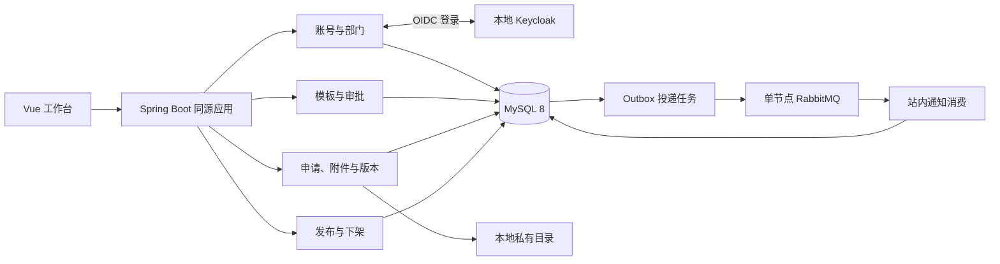

# informationAudit 文件审核与发布系统改造详设

本设计面向下一位实现者。新版面向单机构内的文件发布场景，由提交者准备材料，部门内候选审核员逐级处理，审核通过的版本按计划对本部门发布。重点体验是提交前预览完整路径、按环节展示审核进度、退回后保留原版本，以及重提时对照本次和上次送审内容。

## 1. 交付边界

| 项目 | 决定 |
| --- | --- |
| 现有项目 | 沿用 `fileAudit-manage` 和 `fileAudit_server`。保留 Vue 2、Element UI、Webpack、JDK 13、Spring Boot 2.3.3、MyBatis Starter 2.1.3 和 MySQL 8 作为起点，用现有版本先验证新依赖的兼容性。 |
| 实现基线 | 当前本地工作区已有命名整理和运行修复。开始实现前，检查工作区状态并保存独立的版本基线。只有远端旧源码时，先核对启动类、API 地址、登录行为和前端构建。本文所在提交承载设计文档。 |
| 数据与运行 | 新版从空库 `information_audit_v2` 开始，使用独立存储根目录和默认端口 `8890`。旧数据留在旧系统。新版本启用独立的登录和资源入口，旧控制器及静态附件映射从新版运行配置移除。 |
| 部署规模 | 单机单应用，浏览器与业务接口采用同源。应用与 MySQL 即可跑通本地业务。Keycloak 和单节点 RabbitMQ 可各自按需启用进行真实联调。附件保存在本地私有目录。 |
| 审核能力 | 顺序 1–5 个环节，每个环节一人作出决定。部门管理员角色暂由系统管理员承担。并行会签、条件分支和跨机构审批属于后续扩展条件。 |
| 演示目标 | 两个部门、两套不同级数的模板、一次退回重提、一次定时发布，以及 OIDC 准入和 RabbitMQ 中断恢复。以本地真实联调和可复现演示作为验收。 |

## 2. 页面、人员与权限

### 2.1 角色、归属和权限

每个有效账号属于一个启用的部门，业务角色为提交者、审核员或系统管理员。审核员是一种角色，不按第一、第二级拆角色。环节资格来自送审任务上的候选名单。

| 对象或操作 | 提交者 | 审核员 | 系统管理员 |
| --- | --- | --- | --- |
| 草稿、版本、提交 | 创建和编辑本部门的本人申请 | 保留对自己历史申请的查询权限 | 查询管理所需的申请元数据 |
| 审核任务 | 查看本人申请进度 | 只处理本部门、当前环节且本人在候选名单内的任务 | 跨部门查看任务元数据并进行候选补派 |
| 审批材料 | 查看本人所有版本及该版附件，含调部门前已送审的版本 | 当前同部门候选可看当前版及上一版，已办人员仍在归属部门时可看本人处理过的版本 | 附件读取按本人所属部门和具体业务资格校验 |
| 发布中心 | 查看和获取本部门的已发布附件 | 同左 | 预览和下载仍按发布部门校验，跨部门可管理发布状态 |
| 人员与模板 | 查看本人资料和本部门可用类别 | 查看本部门可用类别与流程 | 管理部门、账号、邀请码、类别、模板和发布状态 |

首次送审时冻结申请所属部门。人员调部门后，可以查看本人在旧部门的历史申请，新申请使用当前所属部门。归属已变更的退回申请保留历史，提交者如需继续可复制为当前部门的新草稿，按新部门类别和模板送审。管理员变更角色、禁用账号或停用部门后，已登录会话的下一次业务请求按最新身份信息校验。提交者本人不得审批自己的申请。

### 2.2 登录和邀请码

- **本地模式。** 登录页提供登录和邀请码注册。用户填写显示名、账号和密码。账号按去除首尾空格、转小写后的值唯一。密码使用 BCrypt 保存。管理员提供一个随机生成的一次性邀请码，代码绑定启用部门，默认有效 7 天，可撤销。数据库保存邀请码摘要。注册成功后进入登录页。
- **OIDC 模式。** 应用使用 Spring Security OAuth2 Client 和标准授权码流程连接 Keycloak。用户在身份服务完成登录，应用以经过验证的 `(issuer, subject)` 关联本地账号。未关联的用户进入邀请码页，准入完成前只可访问会话、邀请码激活和退出接口。首次激活创建默认提交者账号。本地登录名唯一，OIDC 账号只按外部身份唯一，显示名和邮箱可以重复。
- 邀请消费、账号创建和 OIDC 关联在一个事务完成。账号名冲突、部门停用、代码无效或重复提交导致的失败均回滚。并发使用同一码，只允许一个注册成功。已有账号登录后，应用基于会话设置 Cookie，修改类请求校验 CSRF，退出使本应用会话失效。Keycloak 自身的单点登录会话遵循身份服务配置。
- 新库的初始管理员由显式的启动配置生成。本地模式传入部门、登录名和密码。OIDC 模式由身份服务先建立账号，应用以配置中的 `issuer + subject` 和部门创建管理员绑定。开发环境可以添加演示账号和身份关联。公开配置使用占位符，密码、令牌和客户端密钥通过本机环境变量传入。

### 2.3 界面布局

采用深蓝侧栏、浅色内容区、顶部面包屑和当前部门。页面从角色常用操作出发编排。表格左侧优先显示标题和当前进度，右侧固定主要动作。长标题允许单行截断并可读取完整标题，详情承担长说明、审批意见和附件展示。

| 页面 | 建议路由 | 主要信息与行为 |
| --- | --- | --- |
| 登录、注册、加入部门 | `#/login`、`#/register`、`#/join` | 依据环境显示本地登录或 OIDC 入口。处理邀请码无效、使用过期或账号冲突。 |
| 工作台 | `#/workbench` | 提交者看到草稿、审核中和待修改数量。审核员看到待我处理数量及最近任务。管理员有人员、模板和发布管理入口。所有数字来自有权限的服务端查询。 |
| 我的申请 | `#/applications` | 标题、类别、当前环节、已通过数/总环节数、更新时间。主动作按状态显示继续编辑、查看进度或处理退回。 |
| 审核任务 | `#/reviews` | 待办、已办两个列表。增加提交者、当前环节和送审时间。默认待办按送审时间正序，优先处理最早的申请。 |
| 申请详情 | `#/applications/:id` | 左侧显示说明、发布计划和附件，右侧显示当前状态和完整环节时间线。可切换送审版本。重提交后默认展示最新和上一版对照。 |
| 发布中心 | `#/publications` | 标题、类别、发布时间、下架时间和预览入口。使用独立的发布状态，审核环节数量只计算实际审核步骤。 |
| 人员、类别和模板 | `#/management` | 分页查看部门、角色、邀请码及模板。模板编辑页支持调整环节顺序、候选人员和预览路径。发布模板版本时展示版本号。 |
| 我的通知 | `#/notifications` | 展示待审、退回和发布通知。点击时跳转到对应申请或发布条目，再按当前权限校验访问。 |

列表默认每页 20 条，标题或文件名支持关键词搜索，状态和类别可筛选。我的申请按更新时间倒序，发布中心按发布时间倒序，同一时间以 ID 排序。切换筛选重置页码。从详情返回恢复原列表条件。布局以 1440px 和 1024px 桌面宽度验收，窄屏优先保留标题、状态、主要动作，并提供折叠侧栏。空结果、加载和失败分别显示明确提示。

## 3. 模板、送审版本与发布规则

### 3.1 模板及分配

一个部门的一个文件类别在同一时刻有一套启用模板。模板可以保存草稿，发布后形成不可变版本。版本内的环节按顺序编号，环节名称在本模板版本内唯一，每环节至少选一名同部门有效审核员。不同环节的候选人不交叉，确保连续关卡由不同人处理。管理员再次编辑时创建后续版本并发布激活。

提交者选择类别时得到当前启用版本、审核总级数、各级名称及候选人的显示名。首次送审带上页面看到的模板版本号。若管理员同时更新类别绑定，接口返回 `409 TEMPLATE_CHANGED`，页面刷新路径并让用户重新确认。申请锁定绑定后，各次重提沿用首轮的模板版本、环节顺序和所属部门。模板归档保留历史数据。

新轮次按锁定模板复制初始候选名单，继承本申请当前有效的补派记录。首次送审、重提和打开后续关卡时按照在职状态、实际部门和审核角色筛选候选人，并排除提交者。当前环节没有有效候选时，申请仍为审核中，当前环节显示「待补派」。管理员可补派同部门审核员，记录原因、原候选和新候选。工作台只显示当前关卡的有效待办。已处理环节、模板版本及历史人员记录保持原样。补派也须保持当前轮次的不同关卡人员独立。

### 3.2 申请、文件和审批

申请包含标题、文件类别、用途说明、完整的发布开始与结束时间。允许先保存空附件草稿，送审前必须存在一份可读附件及完整信息。前端以北京时间展示，接口使用含时区偏移的 ISO 8601，后端统一转换成 UTC 存储。结束必晚于开始，送审时结束时间必晚于服务端当前时间。

草稿阶段可更新内容、换附件。每次成功送审生成一份不可变的内容和附件引用快照。提交者对退回申请选择「开始修改」后，系统复制上次元数据及附件引用，申请恢复为草稿。重复操作复用该草稿。退回后的草稿可改标题、用途、发布窗口和附件，类别、部门与模板保持原归属。重提成功才生成下一份送审快照和轮次，新一轮从第一关开始。界面依据文件摘要标记附件变化，同时展示文件名、大小和两版预览。字段变化并排显示，默认比较本次和紧邻的上一次送审版本，草稿可单独查看。

| 当前申请状态 | 动作 | 结果 |
| --- | --- | --- |
| `DRAFT` 草稿 | 送审 | 锁定版本并生成新一轮，首环节标为处理中，其余环节标为待处理 |
| `IN_REVIEW` 审核中 | 当前候选通过 | 本环节通过，下一环节开始处理。已是末环节时，申请变为 `APPROVED` 并生成发布记录 |
| `IN_REVIEW` 审核中 | 当前候选退回，并填写原因 | 本环节标为退回，申请变为 `RETURNED`，结束本轮。剩余环节标为本轮未进入 |
| `RETURNED` 已退回 | 提交者开始修改 | 转为 `DRAFT` 并保留被退回的轮次。符合原归属权限时在同一申请下重提 |
| `APPROVED` 审核通过 | 查看 | 显示通过版本和独立发布状态，发布结束后继续保留原审批记录 |

审核决定携带 `roundId`、`stageId` 和 `expectedVersion`。服务端根据会话校验角色、部门、候选资格和当前状态。审批记录、意见、状态转换、下一关打开、时间线和待通知事件在同一 MySQL 事务中提交。使用条件更新确保当前关卡只接受一项决定，其他并发请求返回 `409 REVIEW_CONFLICT` 并刷新。退回原因去除首尾空白后不能为空，最大 1,000 字符。

进度由后端提供 `passedCount`、`totalStages`、`currentStageName` 及完整步骤。处理中显示「第 2/3 环节 · 部门复核」，第二关退回时显示「部门复核退回 · 已通过 1/3」，重提后按新轮次从 0/3 开始。详情支持切换旧轮次并显示各关人员、动作时间和意见。

### 3.3 发布

末环节通过后，发布记录绑定该批准版本及冻结部门。若当前时间已进入 `[startAt, endAt)`，直接变为 `PUBLISHED`。若早于开始，使用 `SCHEDULED`。若达到或超过结束，置为 `OFFLINE`，记录到期原因，申请仍保持审核通过。每 30 秒扫描到期的上架和下架任务，使用状态与版本的条件更新。重启后按当前时间补扫。管理员可填写理由取消计划发布或提前下架，对应记录转为 `OFFLINE` 并标注原因。审批历史持续可查。

发布中心查询、预览和下载都实时检查账号部门、发布状态、开始与结束时间。达到结束时间后立即拒绝发布附件读取，调度随后补记下架事件。已下架的发布入口返回无可用内容，提交者仍可从本人申请查看历史版本。发布和下架只在状态首次实际转换时记录时间线并产生通知。终审时窗口已经结束的申请只记录到期结果。

## 4. 附件预览与存储

- 私有目录按对象标识存放文件。原始文件名只用于展示和下载。限制单文件大小 15 MiB，流式写入临时文件并计算 SHA-256，校验后移到同一文件系统的正式目录，再保存元数据并关联草稿。草稿并发编辑时，条件更新失败的请求删除自己新写入的文件。对进程异常遗留的文件，只在私有目录内复核数据库引用后清理。已送审版本引用的附件保持可读取。
- 首版预览检测 PDF、JPEG、PNG、GIF、WebP 格式。PDF 用桌面浏览器内置阅读器，图片使用图片标签。文本接受 UTF-8 的 TXT、CSV、MD，最多读取前 512 KiB，在安全的纯文本容器中展示，截断时提示。其他格式、损坏文件或浏览器禁用 PDF 内嵌时显示下载入口。预览通过服务端实际检测类型生成响应，客户端提供的扩展名或 MIME 仅作线索。
- 每个文件版本通过业务路由提供预览、下载。响应设置正确类型和 `nosniff`，下载按附件响应。申请附件按角色权限表判定，发布附件按访问者当前部门和时间窗口判定。发布窗口结束后，新的访问请求立即失效。已开始的传输或用户已保存的文件由客户端自行持有。

## 5. 架构、数据与接口

### 5.1 模块边界

后端按 `identity`、`template`、`application`、`review`、`publication`、`notification` 组织。模块内用接口层、应用服务、业务模型和持久化适配区分职责。权限和事务由应用服务执行，领域方法集中维护结果与状态转换。模块通过明确的查询接口和事件交互，Mapper 和数据库行对象归所属模块。流程校验用状态机、固定时钟的单元测试和事务集成测试覆盖。

Spring Boot 使用其管理版本的 Security OAuth2 Client 和 AMQP Starter。先分别跑通标准 OIDC 登录和 RabbitMQ 发布消费的最小真实联调，再接入工作流。保持现有 Java 编译目标与运行命令，新增功能按现有工具链构建。

### 5.2 数据模型

表名在实现时可遵循仓库惯例，以下语义、唯一性和索引是验收约束。所有业务表使用 InnoDB、UTF-8 和 UTC 时间。版本化 SQL 放在数据库目录下，按编号依次应用到新版库。初始化脚本对已建好的同版本库可安全重跑，结构变更使用新的脚本编号。演示数据由单独脚本写入。

| 模型 | 主要内容与约束 |
| --- | --- |
| 部门、账号、外部身份、邀请码 | 保存部门状态、账号状态和角色。规范化的本地登录名唯一，OIDC 以 `issuer + subject` 唯一。邀请码摘要唯一，保存部门、创建、到期和核销信息。 |
| 文件类别、模板、模板版本、环节和候选人 | 类别按部门唯一，类别有当前绑定版本。模板版本号在模板内唯一，版本名下按环节序号和候选账号建立唯一约束。 |
| 申请、草稿、送审版本、附件 | 申请保存提交者、冻结归属、锁定模板版本、当前状态与并发版本号。草稿一申请一条。送审版本号在申请内唯一，保存冻结的内容和附件 ID。附件记录内部对象名、原名、大小、摘要及检测类型。 |
| 审核轮次、环节任务、候选人 | 每次送审产生一轮，关联申请版本。轮次与序号组合唯一，每关只保存一次最终决策。候选名单按任务与账号唯一，并按账号索引支持待办查询。 |
| 操作事件、发布记录 | 事件按申请与时间可查询，保存行为、操作者及必要显示信息。发布记录对批准版本唯一，记录部门、起止时间、状态和下架原因。按部门、状态、时间建立发布列表索引，对调度到期字段建索引。 |
| Outbox 与通知 | 事件 ID 全局唯一，记录待投递状态、尝试计数、下次重试、短租约及最近失败原因。通知按 `eventId + recipientId` 唯一，每个账号有已读状态。 |

### 5.3 API 约定

业务 API 使用 `/api/v2`。登录、邀请码注册、OIDC 准入和登出沿用同源浏览器会话。提交者、部门、候选资格及身份从服务端确定。列表统一接受 `page`、`size`、`q` 和适用的状态或类别参数，页码从 1 开始，默认 20 条，上限 100 条。响应含列表、总数和服务端实际分页参数。重要修改返回更新后的详情或并发版本号。

| 路由组 | 行为 |
| --- | --- |
| `GET /session`，`POST /session/login`，`POST /session/logout` | 获取状态 `GUEST`、`NEEDS_INVITE` 或 `ACTIVE`、业务身份及 CSRF 信息。本地模式用账号密码登录。OIDC 模式从 Spring Security 授权入口开始。 |
| `POST /registrations`，`POST /registrations/oidc` | 本地账户注册、已验证外部身份的邀请码激活。创建申请接口只对已经激活的有效账户开放。 |
| `/admin/departments`、`/admin/accounts`、`/admin/invitations`、`/admin/categories`、`/admin/templates` | 管理员查询和维护。模板版本发布、邀请码撤销与候选补派使用独立动作。 |
| `GET /categories`，`GET /categories/{id}/workflow` | 查询本部门类别和当前模板路径。发布模板后对新申请的选择立即生效。 |
| `GET/POST /applications`，`GET /applications/{id}`，`PUT /applications/{id}/draft` | 查询本人申请、创建草稿、取详情和更新草稿。草稿附件单独上传至 `PUT /applications/{id}/draft/attachment`。 |
| `POST /applications/{id}/submit`，`POST /applications/{id}/revise`，`GET /applications/{id}/versions` | 送审、由退回版本创建编辑稿、列出保留的版本与审批轮次。首次送审携带预览所得模板版本，后续沿用锁定版本。 |
| `GET /reviews`，`POST /reviews/{taskId}/decision` | 审核待办或已办列表，按实际所在部门和候选关系控制。决定提交 `APPROVE` 或 `RETURN`、原因、轮次、环节和并发版本。 |
| `/applications/{id}/versions/{version}/preview`、`/download` | 申请版本的预览和下载。草稿使用同一申请下的 `/draft/preview` 和 `/draft/download`，访问限定本人。 |
| `GET /publications`、`/publications/{id}/preview`、`/download`、`POST /admin/publications/{id}/offline` | 同部门发布中心、按实时窗口鉴权的附件访问、管理员填写理由提前下架。 |
| `GET /notifications`，`POST /notifications/{id}/read` | 站内通知及已读状态，仅限收件人。 |

未登录返回 `401`，操作超出角色或资源权限返回 `403`。未知或已不可用的发布资源返回 `404`，错误输入返回 `400`，不能预览的内容返回 `415`，并发或状态冲突返回 `409`。错误对象包含可判断的 `code`、用户可读提示和请求标识。停用的账号或部门统一失去业务访问权限。业务写操作要求 CSRF 校验。

### 5.4 事件投递与通知

需要发通知的业务事务同时插入 Outbox。首次打开关卡、打开下一关和当前关补派时，给新增有效候选人发待审通知。退回、实际上架和实际下架通知提交者。事件包含事件 ID、类型、申请和轮次标识、收件人 ID、时间及跳转所需数据。附件内容、密码和令牌通过各自的业务链路处理。

| 步骤 | 行为 |
| --- | --- |
| 投递 | 每 5 秒扫描待投递和租约到期记录。通过条件更新领取单条事件。在 RabbitMQ 模式发送到持久化交换机及通知队列，收到发布确认且消息已正确路由后标记已投递。网络失败或服务未启动时保留记录，以递增间隔重试，最长间隔 60 秒。 |
| 消费 | 通知插入并提交后确认消息。数据库以事件 ID 和收件人 ID 去重。消费瞬时失败进行有上限的重试，连续 3 次失败转入死信队列，保留事件 ID 供定位，修复后使用原事件 ID 重放。 |
| 本地模式 | 投递器在进程内调用同一个通知写入服务，成功后标记已投递，复用幂等和重试逻辑。 |
| 故障边界 | RabbitMQ 暂停时，审批决定和待办仍在同一 MySQL 事务完成。消息恢复后的重复投递不产生重复通知。发布调度继续按数据库中的时间和状态运行。 |

加上轻量诊断即可支撑演示。记录待投递数量、最老待投递时长、审核冲突和发布调度延迟。按请求标识和事件 ID 定位失败。启用 Actuator 时，仅向本地或授权管理员暴露健康和必要指标。将 RabbitMQ 连通性作为独立诊断项，以便识别通知降级。

## 6. 本机运行方式

| 配置项 | 约定 |
| --- | --- |
| 数据库和 HTTP | MySQL 8，使用新版独立库。应用默认监听 `127.0.0.1:8890`。沿用 `AUDIT_DB_URL`、`AUDIT_DB_USER` 和 `AUDIT_DB_PASSWORD`。后端提供前端构建文件，开发代理转发业务和认证路由。 |
| 私有文件 | `AUDIT_STORAGE_ROOT` 指向新版独立私有目录，默认部署保持本地。 |
| 登录模式 | `AUDIT_AUTH_MODE` 默认 `local`。设为 `oidc` 时配置 Keycloak 的 issuer、Client ID 和客户端密钥。Keycloak 用机器现有独立 JDK 21，建议本地端口 `8082`，注册实际回调 `http://127.0.0.1:8890/login/oauth2/code/keycloak`。应用继续使用原 JDK。 |
| 通知模式 | `AUDIT_NOTIFICATION_MODE` 默认 `local`，在进程内投递。设为 `rabbitmq` 时连接本机单节点，默认 `127.0.0.1:5672`。Windows 准备与选定 RabbitMQ 版本匹配的 64 位 Erlang。服务联调时按需启动。 |
| 演示与联调 | OIDC 和 RabbitMQ 开关独立，便于只启动要验证的组件。集成测试连接真实服务时使用专用演示账号和文件。版本和可运行命令以实际联调结果固化在启动说明。 |

[Spring Boot 2.3.3 依赖清单](https://docs.spring.io/spring-boot/docs/2.3.3.RELEASE/reference/html/appendix-dependency-versions.html) · [Keycloak 支持的配置](https://www.keycloak.org/server/supported-configurations) · [RabbitMQ Windows 安装要求](https://www.rabbitmq.com/docs/install-windows-manual) · [RabbitMQ 消息可靠性](https://www.rabbitmq.com/docs/reliability)

## 7. 实施顺序与验收

| 阶段 | 交付与验证 |
| --- | --- |
| 1. 基线、身份和权限 | 在新版空库启动。验证本地邀请注册、旧账号名冲突、邀请码过期和并发核销。实测 OIDC 首次登录、邀请码加入本部门和退出。用两个部门的账号验证直接访问接口的权限。 |
| 2. 模板和审核 | 验证普通通知两关、重要公告三关、管理员发布新模板、旧任务沿用原版本、同关两位候选人并发处理、退回原因必填和候选补派。分别检查首关和中间关退回。 |
| 3. 申请版本、预览与工作台 | 完成详情、进度和列表。测试重提从第一关开始，版本字段和附件差异准确。真实 PDF、图片和文本可预览，异常与其他格式可下载。验证两种桌面宽度、关键字空结果、分页恢复和常见失败提示。 |
| 4. 发布、通知与联调 | 用可控时钟断言边界，包含终审时窗口已开始、终审时已到期、按时上架、提前下架、重启后的补处理。故障测试覆盖 RabbitMQ 停机时审批仍成功、恢复后补发、重复投递、死信和重放。同部门与跨部门的发布列表和附件读取分别验收。 |
| 5. 从空库复验 | 后端执行 Maven 测试和打包，前端执行单元测试、页面流程测试和生产构建。用真实 MySQL 和本地应用重走演示，分别启用 OIDC 和 RabbitMQ 复验。记录实际版本、启动命令、账号角色和测试结果。 |

主验收场景从管理员绑定模板开始。提交者用邀请码入部，提交一份需要三关审核的公告。第二关退回后修改标题和附件，从第一关重提。审核员看见两版变化和当前环节，最后一关通过后按时间发布。同部门可预览，其他部门的列表和直接地址均无权限。到期后发布入口失效，并保留审批记录。

## 8. 原创设计与交付记录

以真实完成的功能、界面、状态和历史数据作为登记准备的核对依据。重点整理以下四条能够从页面走到代码和测试的业务设计。

| 设计内容 | 实现后的核对点 |
| --- | --- |
| 部门与类别决定审核路径 | 类别选择页能显示路径和总关数，模板换版后已送审记录仍显示原路径。 |
| 退回与重提的版本证据 | 退回环节、理由、意见与具体版本关联，重提后可对照字段和附件变化。 |
| 审核进度与发布可见性 | 审核进度可查，发布还受部门、时间窗和下架状态共同约束。 |
| 邀请准入与通知恢复 | 可解释外部认证与本地准入，能复现通知暂停与恢复。 |

保留 2021 年原始开发记录、改造前后的版本证据，以及实际体验和测试结果。源码表达使用项目统一命名，注释说明业务规则和选择原因。登记时选定真实版本，按中国版权保护中心届时的申请表及签章承诺核对开发方式、源码和文档。软件未发表也可以依法享有著作权。 [《计算机软件保护条例》](https://ipc.court.gov.cn/zh-cn/news/view-407.html) · [新版登记表说明](https://www.ccct.net.cn/html/bqzx/2026/0318/6637.html)
